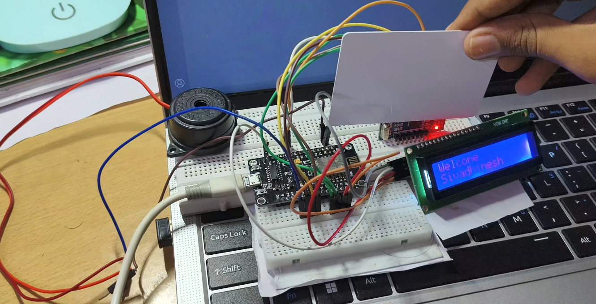
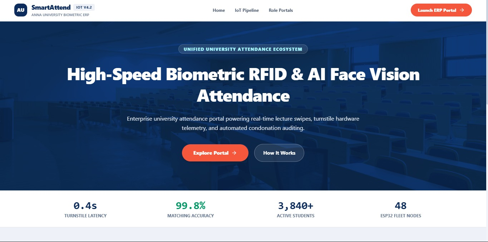
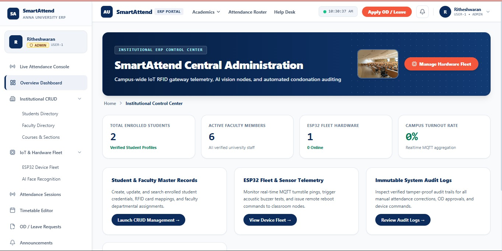
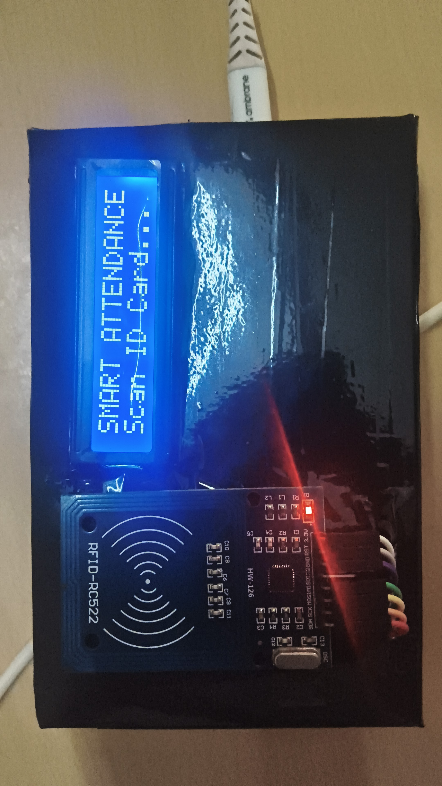
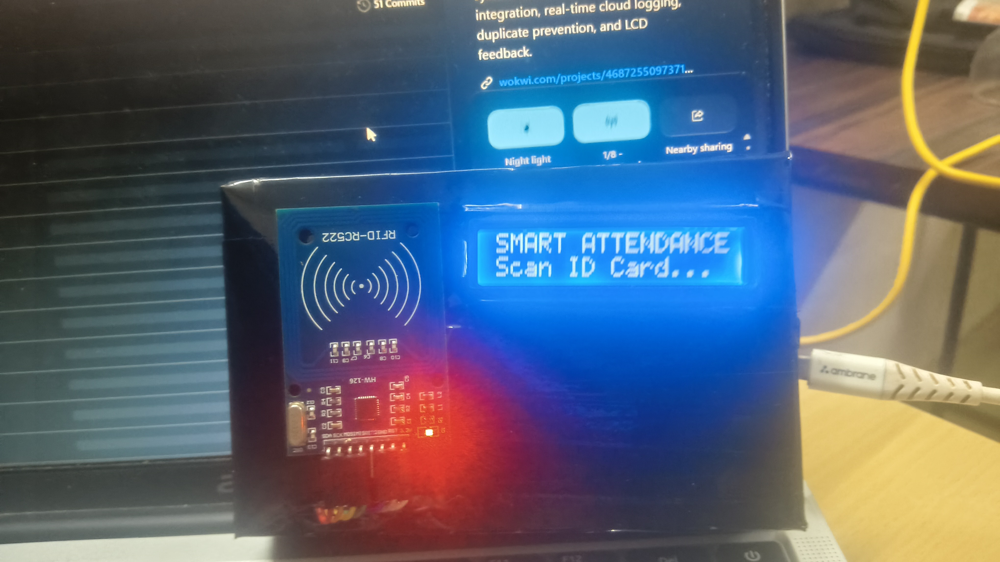
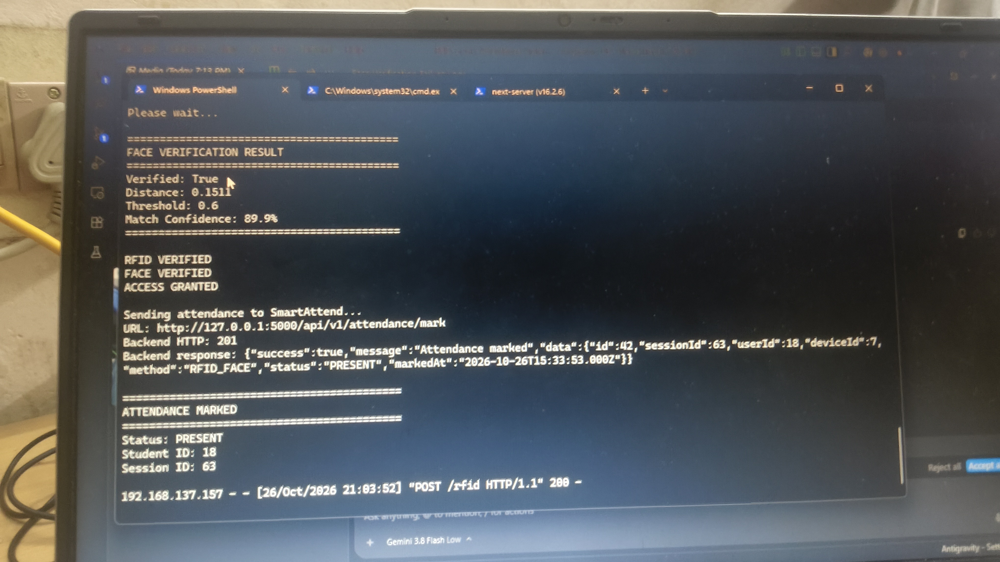
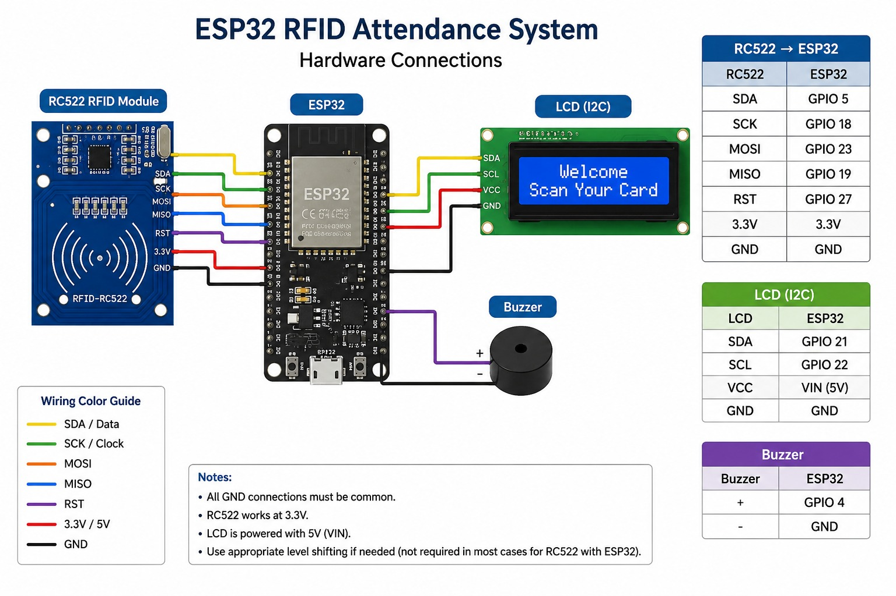

<div align="center">

# 🚀 RFID & Face Recognition Smart Campus System

### A Full-Stack IoT & AI Smart Attendance Management Platform



---


</div>

---

## 📖 The Journey: From Prototype to Production

This project serves as a showcase of scaling a system from a basic hardware prototype into a robust, enterprise-grade application. It demonstrates system design, database modeling, and the integration of Embedded Systems with modern Web Technologies.

### 🌱 Phase 1: Where We Started (The IoT Prototype)
Initially, the project was a hardware-first IoT prototype designed to replace manual roll calls.
- **Hardware:** NodeMCU ESP8266 + MFRC522 RFID reader.
- **Backend & DB:** Google Apps Script and Google Sheets.
- **Features:** Basic RFID scanning, duplicate prevention via Apps Script, and buzzer feedback.

### 🏗️ Phase 2: How We Evolved (The Full-Stack Migration)
As requirements grew, a simple spreadsheet was no longer enough. We needed role-based access control, complex analytics, and a reliable, scalable database.
- **Database Migration:** Moved from Google Sheets to a relational **MySQL** database using **Prisma ORM**.
- **REST API:** Replaced Google Apps Script with a scalable **Node.js/Express** backend.
- **Hardware Upgrade:** Shifted firmware focus to **ESP32** for better peripheral management, moving from Google Sheets integrations to custom REST API payloads.

### 🚀 Phase 3: Where We Are Now (Enterprise Smart Campus)
The system is now a complete ecosystem serving Students, Faculty, and Administrators.
- **Multi-Modal Attendance:** Integrated a **Python-based Face Recognition** system alongside physical RFID scanners.
- **Web Dashboard:** Built a highly responsive **Next.js + Tailwind CSS** frontend portal.
- **Real-Time Telemetry:** Implemented Server-Sent Events (SSE) for live attendance streaming and IoT device monitoring.
- **Advanced Workflows:** Automated On-Duty (OD) request lifecycles, timetable management, automated PDF/CSV report generation, and predictive attendance analytics.

---

## 🏗️ System Architecture

```text
 ┌──────────────────────┐        ┌─────────────────────────┐        ┌──────────────────────┐
 │ ESP32 IoT Terminal   │        │ Python AI Gateway       │        │ Web Dashboard        │
 │ (RC522 + LCD + Buzzer)        │ (Flask + DeepFace 512)  │        │ (Next.js 15 + React) │
 └──────────┬───────────┘        └────────────┬────────────┘        └──────────┬───────────┘
            │                                 │                                │
            │ (1) POST /rfid                  │ (3) POST /attendance/mark      │ (REST API & SSE)
            ▼                                 │                                ▼
 ┌────────────────────────────────────────┐   │     ┌──────────────────────────────────────────┐
 │ Python Edge Gateway (Port 5001)        │───┘     │ Node.js / Express Backend (Port 5000)    │
 │ - Validates RFID card                  │         │ - JWT Auth & Role-Based Access Control   │
 │ - OpenCV Haar Face Box Detection       │         │ - Real-Time SSE Attendance Streams       │
 │ - DeepFace Facenet512 Verification     │         │ - Timetables, Sessions & Analytics       │
 └────────────────────────────────────────┘         └────────────────────┬─────────────────────┘
                                                                         │ (Prisma ORM)
                                                                         ▼
                                                    ┌──────────────────────────────────────────┐
                                                    │ MySQL Database                           │
                                                    │ (Users, Sessions, Attendance, Devices)   │
                                                    └──────────────────────────────────────────┘
```

---

## 🛠️ Technology Stack

| Category | Technologies Used |
|----------|-------------------|
| **Frontend** | Next.js 15, React 19, Tailwind CSS, TypeScript, Lucide Icons |
| **Backend** | Node.js, Express.js, Prisma ORM, Server-Sent Events (SSE), JWT, Zod |
| **Database** | MySQL 8.0+ |
| **IoT / Firmware** | ESP32, RC522 RFID, 16×2 I2C LCD, Active Buzzer, Arduino C++ |
| **AI / Biometrics** | Python 3.10+, OpenCV, DeepFace (`Facenet512` model, cosine distance) |
| **Simulation** | Wokwi |

---

## ✨ Key Features

1. **Dual-Factor Attendance**: RFID tap initiates automated edge face authentication via camera using DeepFace (Facenet512) before marking attendance.
2. **Role-Based Access Control (RBAC)**: Dedicated portal dashboards and permission levels for Students, Faculty (HOD/Dean), and System Admins.
3. **Live Streaming Dashboard**: SSE-powered live class attendance telemetry, showing student scans and verifications in real-time.
4. **IoT Device Management**: Track turnstile and terminal heartbeats, device codes, API keys, and statuses directly from the administrator panel.
5. **Intelligent Attendance Analytics**: Computes streaks, attendance percentages, margin/safe skips, and required classes to meet 75% requirements.
6. **Digital OD (On-Duty) Lifecycle**: Paperless on-duty request submissions with faculty recommendation and admin approval steps.
7. **Automated Reports**: Export compliant PDF statements and Excel/CSV spreadsheets on-demand.

---

## 🚀 Getting Started

### 1. Database Setup
```bash
cd backend
npm install
npx prisma generate
mysql -u root -p < prisma/schema.sql
mysql -u root -p smart_campus_attendance < prisma/seed.sql
mysql -u root -p smart_campus_attendance < prisma/seed-admin.sql
```

### 2. Start the Backend Server (Port 5000)
```bash
# In the backend directory
cp .env.example .env # Configure DATABASE_URL, JWT_SECRET, and PORT
npm run dev
```

### 3. Start the Frontend Dashboard (Port 3000)
```bash
cd frontend
npm install
cp .env.local.example .env.local
npm run dev
```

### 4. Start the Face Recognition Gateway (Port 5001)
```bash
cd face-recognition
python -m venv venv
venv\Scripts\activate   # On Linux/macOS: source venv/bin/activate
pip install -r requirements.txt   # (Flask, deepface, opencv-python, requests)
python code.py
```

### 5. Flash Firmware to ESP32 Terminal
- Open `firmware/esp32-terminal/esp32_classroom_terminal/esp32_classroom_terminal.ino` in Arduino IDE.
- Create `secrets.h` alongside the `.ino` file:
  ```cpp
  #define WIFI_SSID "Your_WiFi_SSID"
  #define WIFI_PASSWORD "Your_WiFi_Password"
  #define GATEWAY_SERVER "http://<YOUR_PC_IP>:5001"
  ```
- Select **ESP32 Dev Module** and upload to your board.

---

## 📸 System Demonstration & Hardware

This project combines physical hardware prototyping with a cloud-managed web dashboard and edge AI face verification.

### 🌐 Web Portal & Administration
<p align="center">
  
</p>
<p align="center">
  
</p>

### 🛠️ Hardware Terminal (ESP32 + RC522 + I2C LCD)
<p align="center">
  &nbsp;&nbsp;
  
</p>

### 🤖 Live AI Face Verification Result
<p align="center">
  
</p>

### 🎥 Video Demonstration
A complete video demonstration of the project, including hardware operation and cloud attendance logging, is available below:
🔗 **Watch Demo Videos:** [Google Drive Folder](https://drive.google.com/drive/folders/1vw_WvM3Md_eeNigcoZ_DopTGOFYCARBb)

### Circuit Diagram
<p align="center">
  
</p>

---

## 🔌 Hardware Wiring & Pinouts (ESP32 Terminal)

<details>
<summary><b>Click to expand hardware wiring pinouts</b></summary>

### MFRC522 RFID Reader
| MFRC522 Pin | ESP32 Pin |
|--------------|-----------|
| SDA (SS)     | GPIO 5    |
| SCK          | GPIO 18   |
| MOSI         | GPIO 23   |
| MISO         | GPIO 19   |
| RST          | GPIO 27   |
| 3.3V         | 3.3V      |
| GND          | GND       |

### 16×2 LCD Display (I2C)
| LCD Pin | ESP32 Pin |
|---------|-----------|
| SDA     | GPIO 21   |
| SCL     | GPIO 22   |
| VCC     | 5V / VIN  |
| GND     | GND       |

### Active Buzzer
| Buzzer Pin   | ESP32 Pin |
|--------------|-----------|
| Positive (+) | GPIO 13   |
| Negative (-) | GND       |

</details>

---

## 🎮 Wokwi Simulation

Don't have the hardware? A complete simulation of the IoT firmware is available on Wokwi:

🔗 **Wokwi Project:** [https://wokwi.com/projects/468725509737183233](https://wokwi.com/projects/468725509737183233)

---

## 📂 Repository Structure

```text
RFID-Smart-Attendance-System
│
├── frontend/             # Next.js 15 Web Dashboard (Admin, Faculty, Student)
├── backend/              # Node.js/Express REST API, SSE & Prisma ORM
├── face-recognition/     # Python Flask Gateway with DeepFace (Facenet512)
├── firmware/             # ESP32 Classroom Terminal Arduino Source Code
├── hardware/             # Circuit Diagrams, Wiring Schematics & BOM
├── scripts/archive/      # Historical patch scripts and database migration tools
├── wokwi/                # Online Simulation Diagram & Configurations
└── README.md             # Project Documentation
```

---

<div align="center">
<i>Built to demonstrate the seamless integration of Embedded Systems, AI, and Modern Web Architectures.</i>
</div>